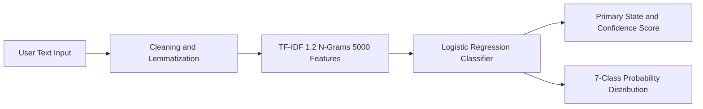
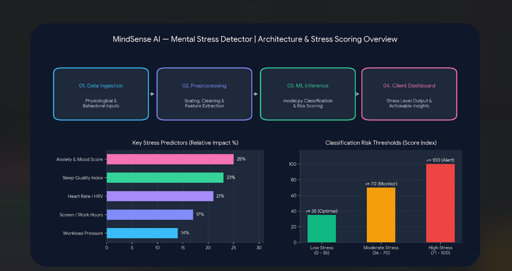
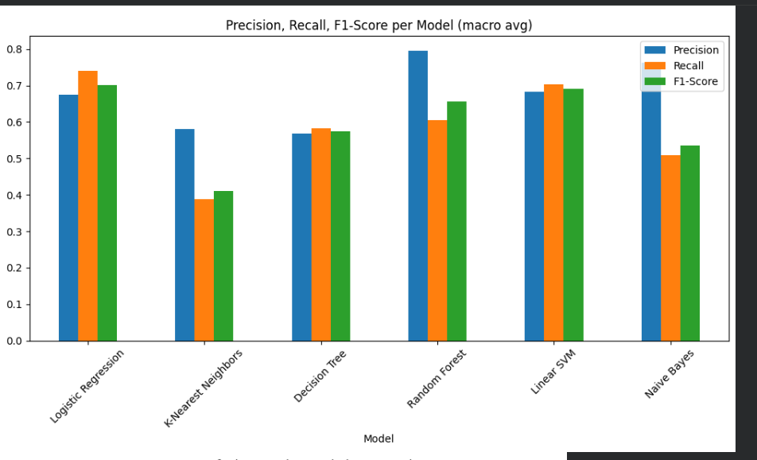
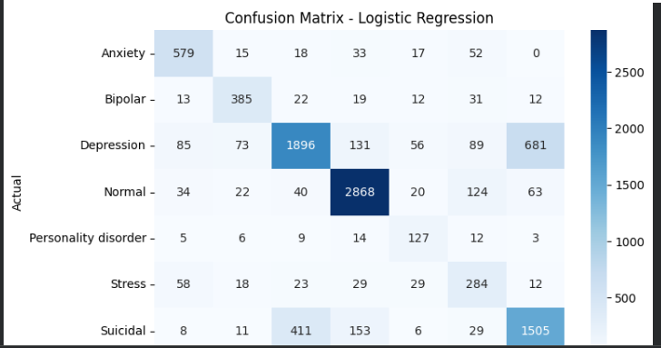
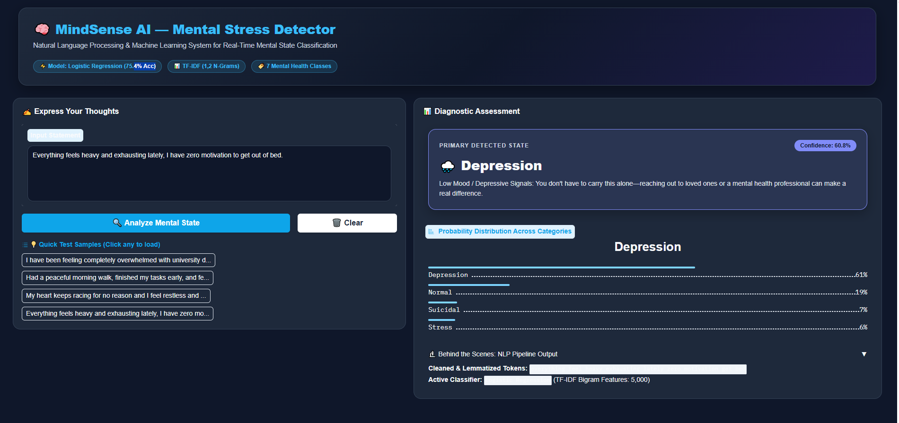

# MindSense AI — Mental Stress Detector

**Client Deliverable | Natural Language Processing & Machine Learning System for Real-Time Mental State Classification**

---

## 1. Project Overview

MindSense AI is an end-to-end Natural Language Processing (NLP) and Machine Learning application designed to analyze free-form user statements and classify mental health and stress indicators in real time. The system preprocesses raw text through tokenization and lemmatization, extracts unigram and bigram TF-IDF features, and runs inference using a trained Logistic Regression classifier across seven distinct psychological state categories.

| Attribute | Specification |
| :--- | :--- |
| **Project Title** | MindSense AI — Mental Stress Detector |
| **Core Objective** | Real-time mental state and stress classification from natural language text inputs |
| **Active Classifier** | Logistic Regression (75.4% Test Accuracy, Top Macro F1-Score) |
| **Feature Engineering** | TF-IDF Vectorizer with (1, 2) N-Grams (5,000 Bigram Features) |
| **Target Categories** | Anxiety, Bipolar, Depression, Normal, Personality Disorder, Stress, Suicidal |
| **Core Modules** | `model.py` (Training & Inference Engine) and `app.py` (Client Interface Runner) |

---

## 2. System Architecture & NLP Pipeline

When a user submits a statement in the interface, the backend executes a deterministic four-stage pipeline. First, raw text is normalized, cleaned of noise, and reduced to base dictionary forms via lemmatization. Second, the cleaned tokens are transformed into a 5,000-dimensional TF-IDF matrix capturing both single words and two-word contextual phrases. Third, the Logistic Regression classifier computes class probabilities across all seven mental health states. Finally, the client dashboard renders the primary detected state, confidence score, category probability distribution, and underlying NLP token diagnostics.

### Architecture & Scoring Overview

---

## 3. Target Classes & Diagnostic Assessment Matrix

The model evaluates user text against seven clinically distinct behavioral and emotional categories. Alongside the primary predicted label and confidence percentage, the application provides supportive guidance tailored to the detected risk level.

| Class Label | Behavioral & Linguistic Indicators | Confidence & Risk Tier | Recommended Action |
| :--- | :--- | :--- | :--- |
| **Normal** | Balanced daily routine, positive outlook, stable mood descriptions | Baseline / Optimal | Maintain current wellness and self-care habits |
| **Stress** | Acute academic, workplace, or time-pressure overwhelm | Moderate Risk | Structured breaks, workload pacing, and stress management |
| **Anxiety** | Persistent worry, restlessness, racing heart, or heightened tension | Moderate-to-High Risk | Grounding exercises, breathing routines, and support check-ins |
| **Depression** | Persistent low mood, exhaustion, loss of motivation, or hopelessness | High Risk | Reach out to trusted support networks or a mental health specialist |
| **Bipolar** | Alternating periods of elevated energy and depressive lows | High Risk | Clinical evaluation and structured mood monitoring |
| **Personality Disorder** | Long-term interpersonal distress and rigid emotional patterns | High Risk | Specialized psychological assessment and therapy |
| **Suicidal** | Explicit or implicit expressions of self-harm or severe crisis | Critical Alert | Immediate crisis intervention and professional helpline support |

---

## 4. Model Benchmarking & Evaluation Results

Six supervised machine learning algorithms were trained and evaluated on the same TF-IDF feature representation using macro-averaged Precision, Recall, and F1-Score to account for class distribution differences across the seven categories.

| Model | Macro Precision | Macro Recall | Macro F1-Score | Selection Status |
| :--- | :---: | :---: | :---: | :--- |
| **Logistic Regression** | ~0.68 | ~0.74 | **~0.70** | **Selected (Best Overall Balance & 75.4% Accuracy)** |
| **Linear SVM** | ~0.68 | ~0.70 | ~0.69 | Runner-up linear baseline |
| **Random Forest** | ~0.80 | ~0.60 | ~0.66 | High precision, lower recall on minority classes |
| **Decision Tree** | ~0.57 | ~0.58 | ~0.57 | Prone to overfitting on sparse n-grams |
| **Naive Bayes** | ~0.76 | ~0.51 | ~0.54 | Strong precision, limited recall across complex classes |
| **K-Nearest Neighbors** | ~0.58 | ~0.39 | ~0.41 | High latency and low recall in high-dimensional space |

### Model Comparison Chart (Precision, Recall, F1-Score)

### Confusion Matrix — Logistic Regression

The confusion matrix below illustrates class-by-class prediction performance for the selected Logistic Regression model across all seven mental health categories, demonstrating strong diagonal separation particularly for **Normal** (2,868 correct), **Depression** (1,896 correct), **Suicidal** (1,505 correct), and **Anxiety** (579 correct).

---

## 5. Application Output & Live Inference Screenshot

The client web interface allows users to enter custom statements or load one-click test samples. In the live diagnostic run shown below, the input statement *"Everything feels heavy and exhausting lately, I have zero motivation to get out of bed."* is processed into lemmatized tokens (`everything feel heavy exhausting lately zero motivation get bed`) and classified as **Depression** with **60.8% confidence**, accompanied by a full probability breakdown across categories.

---

6. Real-World Usages & ApplicationsMindSense AI is designed for seamless integration into digital healthcare, academic, workplace, and personal wellness ecosystems. By processing natural language text inputs in real time, the detector provides scalable early-warning capabilities and actionable insights across various operational environments.Deployment DomainPractical Usage ScenarioKey Benefits & ImpactUniversity & Educational PortalsIntegrated into student wellness check-in portals to monitor exam stress and academic burnout.Enables early intervention by campus counselors before academic performance deteriorates.Corporate HR & Employee PlatformsUsed in anonymous employee sentiment surveys and workplace pulse checks.Helps HR teams identify high-burnout departments and implement workload pacing strategies.Telehealth & Digital Mental Health ClinicsServes as a pre-consultation intake triage tool for mental health practitioners.Prioritizes urgent patient cases and gives clinicians pre-session emotional diagnostics.Crisis Helplines & Online Support ForumsScans incoming forum posts and chat messages for critical self-harm or crisis language.Automatically alerts human moderators for immediate crisis intervention and helpline escalation.Personal Journaling & Wellness AppsPowers daily mood-tracking and self-reflection features in personal wellness apps.Provides users with private, stigma-free self-awareness and personalized coping routines.

## 7. Repository Structure

| File | Description |
| :--- | :--- |
| `model.py` | Core NLP preprocessing, TF-IDF vectorization, and Logistic Regression training/inference script |
| `app.py` | Client-facing application runner and diagnostic formatting module |
| `requirements.txt` | Python package dependencies required to reproduce the environment |
| `README.md` | Complete technical documentation, benchmark tables, and visual results |
| `app_interface_output.png` | Live web interface screenshot showing Depression classification output |
| `architecture_overview.png` | System architecture pipeline and scoring overview diagram |
| `model_comparison_metrics.png` | Macro Precision, Recall, and F1-Score benchmark chart across six classifiers |
| `confusion_matrix_logistic_regression.png` | 7-class confusion matrix for the selected Logistic Regression classifier |
| `.gitignore` | Standard Python ignore rules for cache, virtual environments, and OS metadata |

---

## 8. Setup & Execution Guide

Follow the sequential steps below to clone the repository, install dependencies, and run the model locally.

| Step | Command | Purpose |
| :--- | :--- | :--- |
| **1** | `git clone https://github.com/amalmasoodch/mental-stress-detector.git` | Clone the repository to your local machine |
| **2** | `cd mental-stress-detector` | Navigate into the project directory |
| **3** | `pip install -r requirements.txt` | Install required NLP and machine learning libraries |
| **4** | `python model.py` | Execute model training, evaluation, or standalone prediction |
| **5** | `python app.py` | Launch the client diagnostic interface runner |
