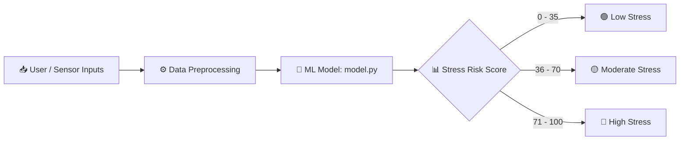

# 🧠 MindSense AI — Mental Stress Detector

> **Client Deliverable | Machine Learning Stress Assessment & Analytics System**

---

## 📊 1. Project Overview

| Attribute | Details |
| :--- | :--- |
| **Project Title** | MindSense AI — Mental Stress Detector |
| **Core Objective** | Automated mental stress classification & risk scoring from user behavioral/physiological inputs |
| **Tech Stack** | Python, Scikit-Learn, Pandas, NumPy, Streamlit / Flask |
| **Primary Module** | `model.py` (ML Inference Engine) & `app.py` (Client Interface) |
| **Output Classes** | `Low Stress` · `Moderate Stress` · `High Stress` |

---

## 🔄 2. System Workflow & Architecture Graph

---

## 📋 3. Stress Classification & Input Matrix

| Stress Level | Score Range | Key Indicators | System Recommendation |
| :--- | :---: | :--- | :--- |
| **🟢 Low Stress** | `0 – 35` | Balanced sleep, stable heart rate, manageable workload | Maintain current routine & wellness habits |
| **🟡 Moderate Stress** | `36 – 70` | Irregular sleep, elevated screen/work hours, mild fatigue | Scheduled breaks, mindfulness & workload pacing |
| **🔴 High Stress** | `71 – 100` | High anxiety score, sleep deprivation, elevated physiological markers | Immediate rest protocol & professional consultation |

---

## 🖼️ 4. Output Screenshots

| Module | Output Preview | Description |
| :--- | :---: | :--- |
| **Client Interface** |  | Input dashboard for entering behavioral & wellness metrics |
| **Prediction Output** |  | Real-time stress classification result and confidence breakdown |

---

## 📁 5. Repository Structure

| File / Folder | Purpose |
| :--- | :--- |
| `model.py` | Core machine learning training & prediction logic |
| `app.py` | Lightweight client-facing application runner |
| `requirements.txt` | Required Python libraries for one-command setup |
| `screenshots/` | Visual architecture graphs and application output screenshots |
| `README.md` | Visual project documentation (tables & diagrams) |

---

## ⚡ 6. Quick Setup & Execution

| Step | Command | Action |
| :---: | :--- | :--- |
| **1** | `git clone https://github.com/amalmasoodch/mental-stress-detector.git` | Clone repository locally |
| **2** | `pip install -r requirements.txt` | Install required dependencies |
| **3** | `python model.py` | Run model training / inference pipeline |
